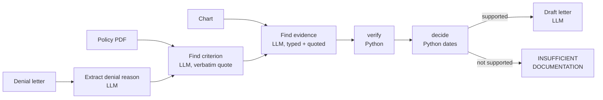

# ChartProof — Project Documentation

Sep 23, 2026 · @Panth Patel

## What ChartProof is

ChartProof drafts prior-authorization denial appeal letters where every factual claim is a verbatim chart quote that code checks, or it refuses when the chart does not support an appeal.

The problem: appealing a prior-auth denial means matching chart evidence to a policy criterion by hand, and an LLM drafting appeals will invent evidence unless something stops it. ChartProof stops it with a deterministic verifier.

**v0 scope (in):**

- One service: MRI lumbar spine without contrast.
- One policy: NIA/Magellan Lumbar Spine MRI guideline (Louisiana Medicaid, public PDF).
- One criterion: failure of conservative treatment for at least six weeks within the last six months.
- Inputs: a denial letter, the policy PDF and a chart, all as local files. Output: an appeal letter or INSUFFICIENT DOCUMENTATION.

**v0 scope (out):** other services or criteria, retrieval across multiple policies, a UI, real patient data, and submitting appeals to a payer.

Repo: `chartproof` on GitHub (private until the blind run is scored and the four pending cases are reviewed).

## How it works

The LLM reads and proposes; plain Python checks every quote and does every date calculation. A run makes about 4 LLM calls per case.

Verification drops any quote not found verbatim in its dated note, or any policy quote not in the policy.

| Step | Done by | Output |
| --- | --- | --- |
| Extract denial reason | LLM | service, denied criterion |
| Find policy criterion | LLM, then Python quote check | verbatim criterion; section label found by Python |
| Find evidence | LLM | items typed treatment\_session, follow\_up or other, each with a quote and note date |
| verify() | Python only | kept items; every dropped item logged with its reason |
| decide() | Python for weeks and the six-month window | supported or not, with the reason |
| Draft letter | LLM, from verified items only | letter with \[Chart: date "quote"\] and \[Policy §\] citations |

Provider layer: every call goes through `llm.py` using an OpenAI-compatible client (OpenRouter by default), temperature 0, with retry and fallback on empty replies, 429 and 5xx. A 402 stops the run immediately.

## Design decisions and rules

Every rule here exists because a run showed the failure it prevents.

| Decision | Reason |
| --- | --- |
| The verifier is plain Python, not an LLM | A second LLM can be fooled the same way as the first; a string match cannot. |
| Quotes must be verbatim and in the note with the stated date | Wrong-date citations would pass a text-only check. |
| The LLM labels evidence types; Python computes weeks | Letting the model pick notes gave 2.0 weeks for a true 3.0 and 7.3 for a true 7.0. |
| Treatment span = first to last conservative treatment of any type (medication or PT) | Matches the policy's "conservative treatment"; follow-ups never extend the span but may be cited as outcome evidence. |
| Temperature 0 | The same case gave 2.0 weeks in one run and 1.0 in another. |
| A parse failure is an INPUT ERROR, never a verdict | The blind run turned unparsed dates into INSUFFICIENT DOCUMENTATION, a false clinical judgment. |
| Quote-mark variants (straight, curly, LaTeX) are treated as equal; nothing else is loosened | The model rewrote quote marks once; changed words must still be dropped. |
| Policy text is cleaned for display only | Footnote markers and PDF glyphs leaked into letters; verification still uses the raw text. |
| Provider-agnostic via OpenRouter | Gemini's free tier hit 503s and a 20-requests-a-day cap; swapping models is one setting. |
| Policy PDF is downloaded, not committed | The guideline is copyrighted. |
| Every result row carries a commit hash | Results from uncommitted or mixed code versions are not comparable. |

The INPUT ERROR, quote-mark and display-cleaning rules are being implemented as of this date; confirm against the commit before treating them as shipped.

## Test data and ground truth

All data is synthetic and generated by Claude Code, so tests prove correctness only once a human has set the expected answers.

**Hand-built cases (6):** supported, insufficient, messy, borderline\_under, borderline\_exact, stale. Each has `denial.txt`, `chart.txt` and `expected.json`, and every file starts with a SYNTHETIC marker.

`expected.json` holds verdict, weeks, required, optional and forbidden citations, and `reviewed_by`. The test passes when every required note is cited, nothing outside required plus optional is cited, no forbidden note is cited, and weeks match to one decimal.

| Case | Tests | Reviewed by |
| --- | --- | --- |
| messy | abbreviations, an unrelated note, follow-up as optional citation; 7.0 weeks | panth |
| supported | clear pass; 7.0 weeks | pending |
| insufficient | 3.0 weeks plus "declined further PT" | pending |
| borderline\_under | 5.7 weeks with a follow-up at 6.5 that must not count | pending |
| borderline\_exact | exactly 6.0 weeks passes | pending |
| stale | 7 weeks that ended 8 months before the denial | pending |

**Blind set (20):** `cases_blind/case_001`–`case_020`, with neutral names and no hints in the content. Answers are in `ground_truth/key.json`, which the pipeline must never read. `run_blind.py` runs the cases within the daily quota and resumes where it stopped; `score_blind.py` is run only by hand once all 20 are done. The key is itself generated, so every mismatch gets a human read of the chart.

## Results log

The latest trusted result is 13/13 tests at commit `0a33434`; the first blind run was discarded because the pipeline could not parse its date format.

| Date (ET) | Commit | Model | Run | Outcome | Status |
| --- | --- | --- | --- | --- | --- |
| 2026-09-23 | scripts `0285a65`, pipeline uncommitted | nemotron-3-super-120b-a12b:free | Blind set, 3 of 20 | All 3 INSUFFICIENT; 0 of 12 quotes verified because note dates were not parsed | Discarded; rerun after the parse fix |
| 2026-09-22, 8:00 pm | `0a33434` | nemotron-3-super-120b-a12b:free | 5 hand-built cases + pytest | 13/13 tests; all verdicts and weeks correct; 15 of 35 requests were empty-reply retries | Trusted, except messy had no weeks or citation assertion then |
| 2026-09-22 | none (pre-commit) | nemotron-3-super-120b-a12b:free | 3 cases + pytest | Verdicts right, weeks wrong (2.0 vs 3.0, 7.3 vs 7.0) | Superseded |
| 2026-09-22 | none (pre-commit) | gemini-3.8-flash | messy + insufficient | Verdicts right; supported never finished (503s, daily cap) | Superseded (pre-decide() change) |

Cost so far: about $0.06 on OpenRouter; every other run used free-tier models.

## Known limitations and open questions

The biggest limitation is that no human has yet reviewed five of the six hand-built cases, so most passing tests still check Claude Code's own answers.

- **Synthetic charts only.** Real charts are longer, messier and use formats the parser has never seen.
- **Claude Code has read the blind key** while writing the scorer. The pipeline was not changed after that, but later changes are format-only by rule.
- **Free model reliability.** 43% of requests in the last clean run needed a retry; a live demo needs a separately chosen model.
- **One criterion, one policy.** No retrieval, no other services, no red-flag exceptions.

* [x] Review the five pending cases and flip `reviewed_by` to panth
* [ ] Confirm the stale case and the six-month window check exist at the latest commit
* [ ] Blind case\_002 is a neck-pain chart against a lumbar policy: generator mistake or a deliberate mismatch test? Answer from the score, not the key
* [ ] Choose a demo model
* [ ] Make the repo public after the blind run is scored
