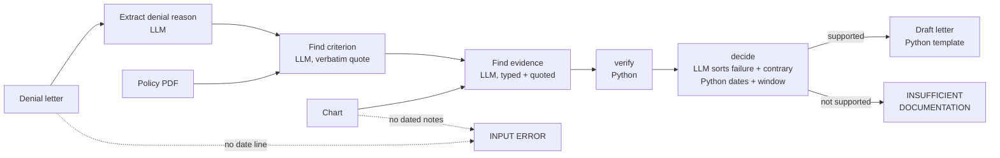

# ChartProof — Project Documentation

Sep 23, 2026 · @Panth Patel

## What ChartProof is

ChartProof drafts prior-authorization denial appeal letters where every factual claim is a verbatim chart quote that code checks, or it refuses when the chart does not support an appeal.

The problem: appealing a prior-auth denial means matching chart evidence to a policy criterion by hand, and an LLM drafting appeals will invent evidence unless something stops it. ChartProof stops it with a deterministic verifier.

**v0 scope (in):**

- One service: MRI lumbar spine without contrast.
- One policy: NIA/Magellan Lumbar Spine MRI guideline (Louisiana Medicaid, public PDF).
- One criterion: failure of conservative treatment for at least six weeks within the last six months.
- Inputs: a denial letter, the policy PDF and a chart, all as local files. Output: an appeal letter or INSUFFICIENT DOCUMENTATION, or `INPUT ERROR` (exit status 1) when the chart or denial dates cannot be parsed.

**v0 scope (out):** other services or criteria, retrieval across multiple policies, a UI, real patient data, and submitting appeals to a payer.

Repo: `panther1202/ChartProof` on GitHub (private until the blind run is scored).

## How it works

The LLM reads and proposes; plain Python checks every quote and does every date calculation. A case makes 4 LLM calls when at least one chart quote survives verification, 3 when none does (decide() stops before its call), and none when the input fails to parse. The letter is a Python template, not an LLM call. Retries can add requests: an invalid JSON reply is re-asked once, and each OpenRouter call makes up to 3 attempts.

Verification drops any chart quote not found in the note carrying its stated date. If the policy quote is not in the policy, the run stops rather than cite it. Matching ignores case, whitespace and quote-mark style, and nothing else.

| Step | Done by | Output |
| --- | --- | --- |
| Parse dates | Python, before any LLM call | note dates and denial date, or INPUT ERROR |
| Extract denial reason | LLM | service, denied criterion |
| Find policy criterion | LLM, then Python quote check | verbatim criterion; section label found by Python |
| Find evidence | LLM | items typed treatment\_session, follow\_up or other, each with a quote and note date |
| verify() | Python only | kept items; every dropped item logged with its reason |
| decide() | One LLM call picks the failure and contrary items; Python computes weeks and applies the six-month window | supported or not, with the reason |
| Draft letter | Python template, from verified items only | letter with \[Chart: date "quote"\] and \[Policy §\] citations |

Provider layer: every call goes through `ask()` in `appeal.py`, at temperature 0, with JSON output validated by pydantic. With `OPENROUTER_API_KEY` set it POSTs to OpenRouter's OpenAI-compatible chat-completions endpoint with `requests` (model from `OPENROUTER_MODEL`, default `google/<GEMINI_MODEL>`); otherwise it calls Gemini (`gemini-3.8-flash`) through the google-genai SDK. OpenRouter requests are spaced 3.5 s apart and retried, 20 s apart, up to 3 attempts on 429, 502, 503 or an empty reply; the Gemini SDK retries 429 and 5xx up to 3 attempts. There is no automatic model fallback. Any other HTTP error, including 402 (out of credit), stops the run immediately.

## Design decisions and rules

Each rule lists the reason it exists and the commit that shipped it.

| Decision | Reason | Shipped in |
| --- | --- | --- |
| The verifier is plain Python, not an LLM | A second LLM can be fooled the same way as the first; a string match cannot. | `5f18ba7` |
| Quotes must be verbatim and in the note with the stated date | Wrong-date citations would pass a text-only check. | `5f18ba7` |
| The LLM labels evidence types; Python computes weeks | Letting the model pick notes gave 2.0 weeks for a true 3.0 and 7.3 for a true 7.0. | `5f18ba7` |
| Treatment span = first to last verified treatment\_session of any type (medication or PT) | Matches the policy's "conservative treatment"; follow-ups never extend the span but may be cited as outcome evidence. | `5f18ba7`; citation rule `30eedd0` |
| The six-month window is measured back from the denial letter's date; only sessions on or after that date count toward it | Measured from the latest chart note (the rule before `30eedd0`), a chart that stops after an old course always looks inside the window. | `30eedd0` |
| Temperature 0 | The same case gave 2.0 weeks in one run and 1.0 in another. | `5f18ba7` |
| A parse failure is an INPUT ERROR, never a verdict | The blind run turned unparsed dates into INSUFFICIENT DOCUMENTATION, a false clinical judgment. | `e169ac1` |
| Quote-mark variants (straight, curly, LaTeX) are treated as equal; nothing else is loosened beyond the existing case and whitespace tolerance | The model rewrote quote marks once; changed words must still be dropped. | `e169ac1` |
| Policy text is cleaned for display only | Footnote markers and PDF glyphs leaked into letters; verification still uses the raw text. | `e169ac1` |
| Provider-agnostic via OpenRouter | Gemini's free tier hit 503s and a 20-requests-a-day cap; swapping models is one setting. | `5f18ba7` |
| Policy PDF is downloaded, not committed | The guideline is copyrighted. | `5f18ba7` |
| Every result row carries a commit hash | Results from uncommitted or mixed code versions are not comparable. | `ccea765` |

## Test data and ground truth

All data is synthetic and generated by Claude Code, so tests prove correctness only once a human has set the expected answers.

**Hand-built cases:** supported, insufficient, messy, borderline\_under and borderline\_exact are committed, each with `denial.txt` and `chart.txt`. The sixth case, `cases/stale/`, and all six `expected.json` files exist only in the working tree and are not committed yet. Every `.txt` file starts with a `SYNTHETIC TEST DATA` line.

`expected.json` holds `verdict`, `weeks`, `required_citations`, `optional_citations`, `forbidden_citations` (note dates as MM/DD) and `reviewed_by`. `test_case_matches_expected` passes when the verdict and output header match, every required note is cited, nothing outside required plus optional is cited, no forbidden note is cited, and weeks match to one decimal; for stale, the reason must also name the six-month window. The test reads `cases/*/expected.json`, so on a clean checkout of HEAD it runs no cases.

| Case | Tests | reviewed\_by (uncommitted file) |
| --- | --- | --- |
| messy | abbreviations, an unrelated note, follow-up as optional citation; 7.0 weeks | panth |
| supported | clear pass; 7.0 weeks | panth |
| insufficient | 3.0 weeks plus "declined further PT" | panth |
| borderline\_under | 5.7 weeks with a follow-up at 6.5 that must not count | panth |
| borderline\_exact | exactly 6.0 weeks passes | panth |
| stale | 7 weeks that ended 8 months before the denial (case not committed) | panth |

**Blind set (20):** `blind_test_set/cases_blind/case_001`–`case_020`, with neutral names and no hints in the content. Answers are in `blind_test_set/ground_truth/key.json`; `run_blind.py` reads inputs only through `blind_pipeline_guard.py`, which refuses any path under `ground_truth/`. `run_blind.py` needs `OPENROUTER_API_KEY`, checks the free-model quota before each case, stops when fewer than 5 requests remain today, and resumes at the next case without a result in `results_blind/`. `score_blind.py` is run only by hand once all 20 are done. The key is itself generated, so every mismatch gets a human read of the chart.

## Results log

The latest trusted result is 13/13 tests at commit `0a33434`; the first blind run was discarded because the pipeline could not parse its date format. No run has been recorded at `30eedd0` or `e169ac1`, the two pipeline commits since.

| Date (ET) | Commit | Model | Run | Outcome | Status |
| --- | --- | --- | --- | --- | --- |
| 2026-09-23 | scripts `0285a65`, pipeline uncommitted | nemotron-3-super-120b-a12b:free | Blind set, 3 of 20 | All 3 INSUFFICIENT; 0 of 12 quotes verified because note dates were not parsed | Discarded; rerun after the parse fix |
| 2026-09-22, 8:00 pm | `0a33434` | nemotron-3-super-120b-a12b:free | 5 hand-built cases + pytest | 13/13 tests; all verdicts and weeks correct; 15 of 35 requests were empty-reply retries | Trusted, except messy had no weeks or citation assertion then |
| 2026-09-22 | none (pre-commit) | nemotron-3-super-120b-a12b:free | 3 cases + pytest | Verdicts right, weeks wrong (2.0 vs 3.0, 7.3 vs 7.0) | Superseded |
| 2026-09-22 | none (pre-commit) | gemini-3.8-flash; gemini-3-flash-preview for messy | messy + insufficient | Verdicts right; supported never finished (503s, daily cap, then OpenRouter 402) | Superseded (pre-decide() change) |

Cost so far: about $0.06 on OpenRouter; every other run used free-tier models.

## Known limitations and open questions

The biggest limitation is that HEAD carries no ground truth for the hand-built cases: the six `expected.json` files and the stale case are uncommitted, so the expected-answer tests run nothing on a clean checkout.

- **Synthetic charts only.** Real charts are longer, messier and use formats the parser has never seen.
- **Claude Code has read the blind key** while writing the scorer (`0285a65`). Two pipeline commits followed: `30eedd0` (six-month window, a verdict-logic change) and `e169ac1` (date formats, INPUT ERROR, quote-mark matching, display cleaning). Read the blind score with that in mind.
- **Free model reliability.** 15 of 35 requests (43%) in the last clean run were empty-reply retries; a live demo needs a separately chosen model.
- **One criterion, one policy.** No retrieval, no other services, no red-flag exceptions.

* [ ] Commit `cases/stale/` and the six `expected.json` files (all say `reviewed_by: panth`; confirm each was reviewed by hand first)
* [x] Six-month window check is in decide() since `30eedd0`
* [ ] Rerun the hand-built cases and pytest at HEAD and log the result
* [ ] Blind case\_002 is a neck-pain chart against a lumbar policy: generator mistake or a deliberate mismatch test? Answer from the score, not the key
* [ ] Choose a demo model
* [ ] Make the repo public after the blind run is scored
